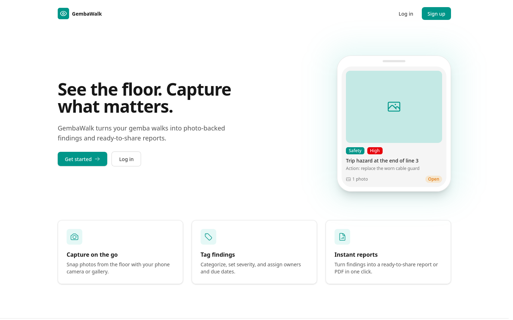
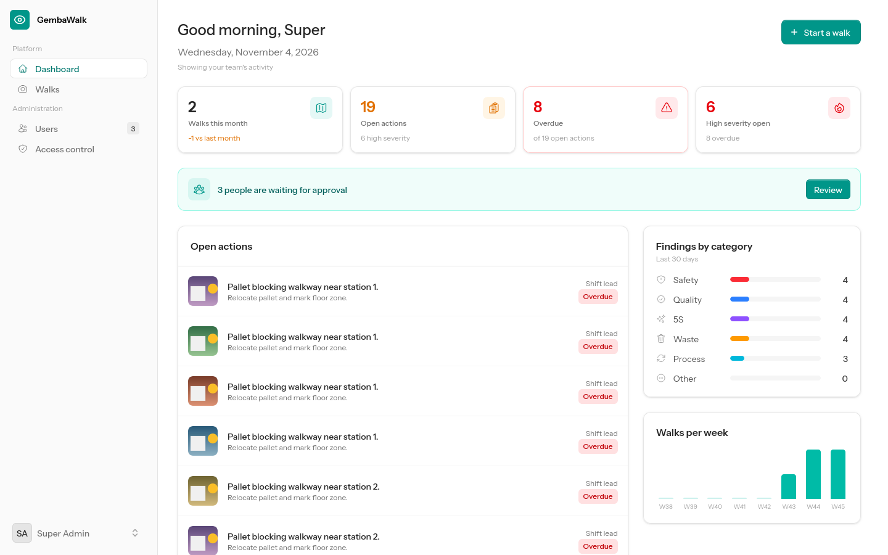
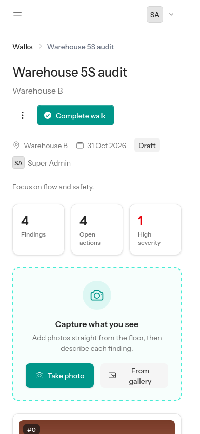
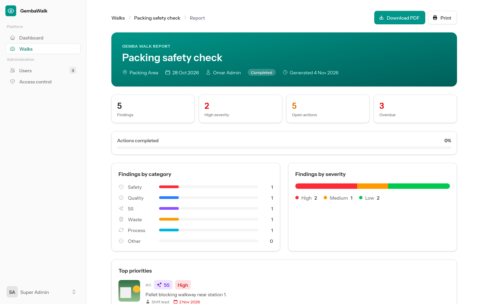
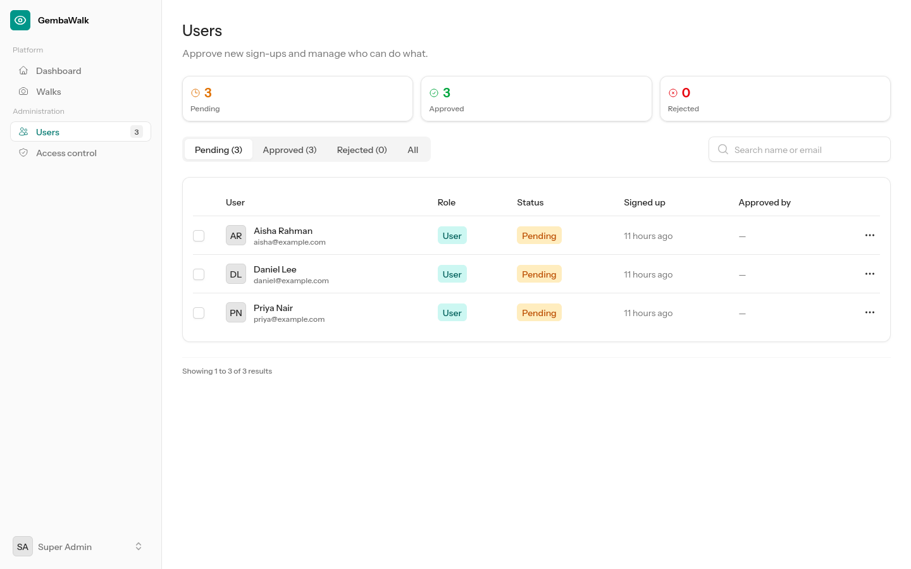
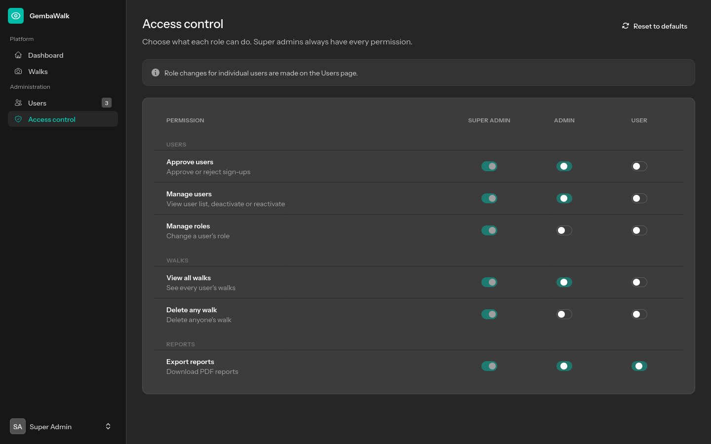

# GembaWalk

GembaWalk is a web app for running **gemba walks**: going to the shop floor, photographing what you see, and turning those photos into findings and a shareable report.

On a phone you start a walk, tap **Take photo**, and describe each photo as a finding (category, severity, what should be done, who owns it, by when). When the walk is done, GembaWalk builds a report with charts, the photo evidence and an action plan, and you can download it as a PDF.



## Features

- **Photo capture on the floor.** "Take photo" opens the phone camera, and "From gallery" uploads several photos at once. Photos are rotated upright, resized, and stripped of location (GPS) data before they're stored.
- **Findings.** Each photo is tagged with a category (Safety, Quality, 5S, Waste, Process, Other), a severity (Low, Medium, High), an observation, an action, an owner and a due date. Overdue actions are highlighted.
- **Walk workflow.** Walks start as drafts. A walk can only be completed once every finding has a description. Owners can reopen completed walks, and actions can still be marked done after a walk is completed.
- **Reports.** Each walk has an on-screen report with summary numbers, category and severity charts, top priorities, a photo grid and an action plan. You can print it or download it as an A4 PDF.
- **Dashboard.** Shows walks this month, open and overdue actions, high-severity findings, a category breakdown, walks per week, and recent walks. Admins see the whole team's numbers.
- **Sign-up approval.** New accounts stay *pending* until an admin approves them. Admins get an email when someone signs up, and users get an email when they're approved or rejected.
- **Roles and permissions.** There are three roles: User, Admin and Super Admin. The super admin decides what Admins and Users may do from a permission grid.
- **Mobile first, with dark mode.**

| Dashboard | Walk on a phone |
|---|---|
|  |  |



## Roles and permissions

| Role | Who it's for | What it can do |
|---|---|---|
| **User** | People doing the walks | Create walks and findings, and see **their own** walks and reports |
| **Admin** | Supervisors / managers | Everything a User can do, plus whatever permissions the super admin grants (by default: approve and manage users, view all walks, export reports) |
| **Super Admin** | System owner | Every permission, plus the **Access control** page and the ability to create other super admins |

The permissions the super admin can switch on or off for the Admin and User roles:

| Permission | Allows |
|---|---|
| `users.approve` | Approve or reject sign-ups |
| `users.manage` | View the user list, deactivate or reactivate accounts |
| `roles.manage` | Change a user's role (only a super admin can grant Super Admin) |
| `walks.view_all` | See every user's walks and reports |
| `walks.delete_any` | Delete anyone's walk |
| `reports.export` | Download PDF reports |

Some rules hold no matter how permissions are set:
- Nobody can act on their own account.
- Only a super admin can manage another super admin.
- The last super admin can't be demoted.
- A walk can only be edited by its owner, and only while it's a draft.

| Users | Access control |
|---|---|
|  |  |

## Tech stack

- **Laravel 12** (PHP 8.2+), built on the official **Livewire starter kit**
- **Livewire 4 + Volt** for the interactive pages, and **Flux UI** (free components) with **Tailwind CSS 4** for the look
- **spatie/laravel-permission** for roles and permissions
- **intervention/image v3** (GD) for photo processing
- **barryvdh/laravel-dompdf** for PDF reports
- **Laravel Sail** (Docker) with **MySQL 8.4** and **Mailpit**

The app calls no external or paid APIs. PDFs are rendered locally, with remote loading and inline PHP turned off.

## Getting started

You need **Docker** and **Node.js** installed. PHP and Composer run inside Docker, so you don't need them on your machine.

```bash
git clone https://github.com/aqeelmailwork-dev/gembawalk.git
cd gembawalk
cp .env.example .env

# Install PHP dependencies using a throwaway Sail container
docker run --rm -u "$(id -u):$(id -g)" -v "$(pwd):/var/www/html" -w /var/www/html \
    laravelsail/php84-composer:latest composer install --ignore-platform-reqs

# Start the app, MySQL and Mailpit
./vendor/bin/sail up -d

# Set up the app (wait ~10 seconds after `up` the first time, while MySQL starts)
./vendor/bin/sail artisan key:generate
./vendor/bin/sail artisan migrate --seed
./vendor/bin/sail artisan storage:link

# Build the front end
./vendor/bin/sail npm install
./vendor/bin/sail npm run build
```

Now open:

| What | Address |
|---|---|
| The app | http://localhost |
| Mailpit (emails the app sends) | http://localhost:8025 |

### First login

`migrate --seed` creates a super admin from `SUPER_ADMIN_EMAIL` and `SUPER_ADMIN_PASSWORD` in `.env`. The defaults are:

```
superadmin@gembawalk.test / password
```

**Change these before seeding anywhere other than your own machine.** Re-running the seeder never resets a password that has already been changed.

### Everyday commands

| Task | Command |
|---|---|
| Start | `./vendor/bin/sail up -d` |
| Stop | `./vendor/bin/sail down` |
| Run tests | `./vendor/bin/sail test` |
| Rebuild styles while editing | `npm run dev` |
| Any artisan command | `./vendor/bin/sail artisan …` |

### Using it from a phone

Connect the phone to the same Wi-Fi and open `http://<your-computer's-IP>`. Some browsers only open the camera directly over HTTPS or `localhost`. Over plain HTTP, the **From gallery** button still works and lets you take a new photo.

## Deploying to a home server

This is for running GembaWalk on a home server (an Ubuntu box, for example) with Docker Compose, so phones on your Wi-Fi can reach it. You need **Docker** with the **Compose plugin**, and **git**.

```bash
git clone https://github.com/aqeelmailwork-dev/gembawalk.git
cd gembawalk
cp .env.production.example .env
```

Edit `.env` and at least set the passwords, `SUPER_ADMIN_EMAIL`, `SUPER_ADMIN_PASSWORD`, and `APP_KEY` (next step).

Generate an app key and paste it into `APP_KEY` in `.env`:

```bash
docker compose -f compose.production.yaml run --rm --no-deps app php artisan key:generate --show
```

Build and start everything. The first build installs PHP dependencies and compiles the front end, so give it a few minutes:

```bash
docker compose -f compose.production.yaml up -d --build
```

Seed the database once (creates the roles, permissions and your super admin):

```bash
docker compose -f compose.production.yaml exec app php artisan db:seed --force
```

On first start the app runs `migrate --force`, creates the `public/storage` link and caches config, routes and views automatically.

| What | Address |
|---|---|
| The app | http://<server-ip>:8090 |
| Mailpit (emails the app sends) | http://<server-ip>:8091 |

### HTTPS from phones

Browsers usually only open the camera over HTTPS. Tailscale serve gives you that without opening any ports:

```bash
sudo tailscale serve --bg --https=8443 8090
```

Then open `https://<machine>.<tailnet>.ts.net:8443` on the phone (tailnet only — not public). Tailscale terminates TLS and forwards to `http://127.0.0.1:8090`; the app trusts those forwarded headers, so links and assets keep the right scheme and host. Plain `http://<server-ip>:8090` on the LAN keeps working too. Do not use `tailscale funnel` unless you want it public.

### Updating

```bash
git pull
docker compose -f compose.production.yaml up -d --build
```

### Backups

Everything worth keeping lives in two named volumes: `gembawalk-prod_gembawalk-mysql` (the database) and `gembawalk-prod_gembawalk-storage` (photos and Livewire temporary uploads). Back them up by running a throwaway container against each volume, for example:

```bash
docker run --rm -v gembawalk-prod_gembawalk-mysql:/data -v "$(pwd)":/backup alpine tar czf /backup/mysql.tgz -C /data .
```

## Project structure

| Path | What's there |
|---|---|
| `app/Enums/` | Roles, permissions, user status, walk status, finding category, severity, action status |
| `app/Models/` | `User`, `GembaWalk`, `Finding` |
| `app/Policies/` | Who may view, edit, complete, reopen, delete and export walks and findings |
| `app/Services/FindingPhotoProcessor.php` | Photo orientation, resizing, thumbnails and metadata stripping |
| `app/Support/PermissionMatrix.php` | Default permissions for each role (used by the seeder and "Reset to defaults") |
| `app/Support/WalkReport.php` | All report numbers, shared by the report page and the PDF |
| `app/Http/Controllers/WalkReportPdfController.php` | PDF download |
| `resources/views/livewire/walks/` | Walk list, create/edit, walk page (capture and findings), report |
| `resources/views/livewire/admin/` | Users page and Access control page |
| `resources/views/livewire/dashboard.blade.php` | Dashboard |
| `resources/views/reports/walk-pdf.blade.php` | PDF layout |
| `tests/Feature/` | Feature tests for access, approval, walks, findings, reports and the dashboard |

## Testing

```bash
./vendor/bin/sail test
```

Run tests through Sail: photo processing needs PHP's **GD** extension, which the Sail container has but your machine may not.

## Notes

- **iPhone photos:** HEIC photos aren't supported, because GD can't read them. The app says so and suggests setting the camera to *Settings > Camera > Formats > Most Compatible*.
- **Upload limits:** JPG, PNG or WebP, up to 12 MB per photo and 20 photos per upload.
- **Timezone:** the app runs on UTC, which affects greetings, due dates and overdue checks. To use your local time, change `'timezone' => 'UTC'` in `config/app.php`, for example to `'Asia/Kuala_Lumpur'`.
- **Storage link:** run `storage:link` through Sail as shown above. A link created on the host points to a host path that doesn't exist inside the container, and photos then fail to load.
